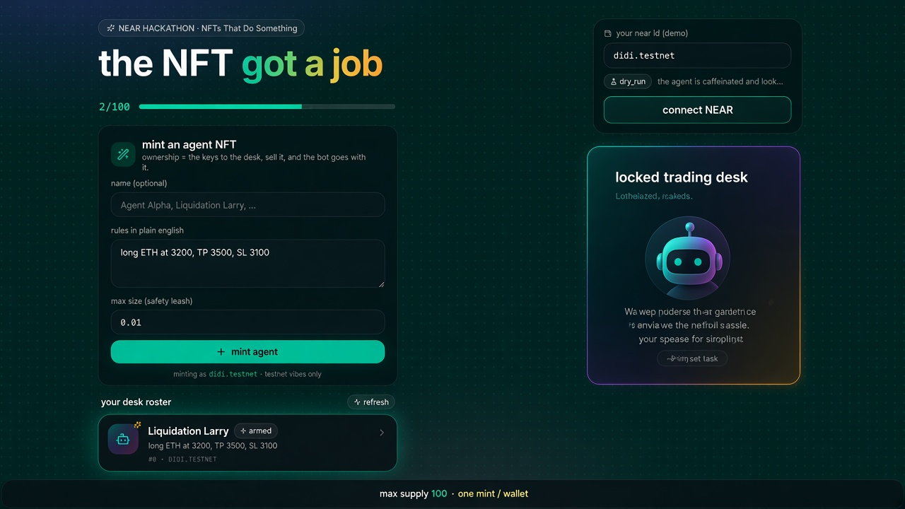
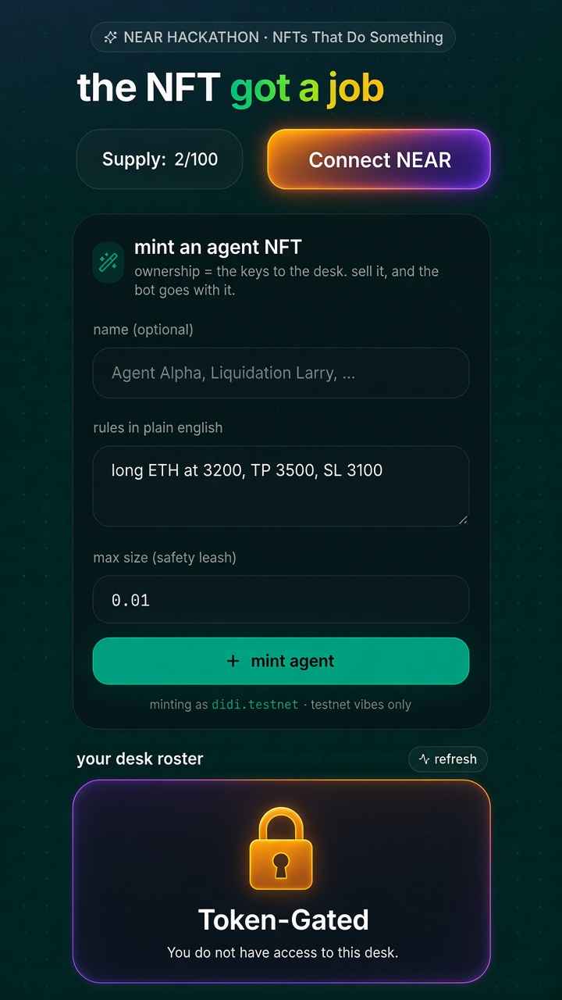

# Bag Worker

> An NFT that **is** a Hyperliquid perp trading agent. Own the NFT → own the desk.

Built for **NEAR HACKATHON** · track: **NFTs That Do Something** · testnet only.



## Pitch

- **NEP-171 agent NFT** with on-chain rules + max size.
- **First drop: max supply 100**, enforced in the contract (`MAX_SUPPLY`).
- **One mint per wallet** (`minted_by_owner` map) — still transferable (control moves with the token).
- Unique **robot traits** + funny names; mood shifts with (demo) performance.
- Plain-English rules → Hyperliquid **testnet** TP/SL (`normalTpsl`). Dry-run by default.
- Mobile-first Next.js UI with Wallet Selector (Meteor / MyNearWallet), live **`x/100`** mint counter, locked desk without an NFT, and a ridiculous sold-out state.

## Live counter

Contract view `get_mint_stats` and API `GET /api/mint-stats` both return:

```json
{ "minted": 2, "max_supply": 100, "remaining": 98, "sold_out": false }
```

UI shows `2/100` and swaps to a funny sold-out panel at 100/100.

## Stack

| Layer | Tech |
| --- | --- |
| Contract | Rust / `near-sdk`, NEP-171 + agent extras → `contract/` |
| Agent API | FastAPI + rule parser + Hyperliquid testnet SDK → `agent/` |
| Web | Next.js 15, Tailwind, framer-motion, NEAR Wallet Selector → `web/` |

## Quick start

```bash
# API (dry-run HL)
cd near-agent-nft
python -m venv .venv && source .venv/bin/activate
pip install -r requirements.txt
uvicorn agent.main:app --reload --port 8787

# Web
cd web
cp ../.env.example .env.local   # optional
npm install
npm run dev   # http://localhost:3000  (proxies /api → :8787)
```

Connect a **testnet** wallet → mint your one agent → write rules → fire a dry-run order.

## Contract (NEAR testnet)

```bash
cd contract
RUSTFLAGS='--cfg near' cargo test
RUSTFLAGS='--cfg near' cargo build --target wasm32-unknown-unknown --release
# wasm: res/perp_agent_nft.wasm

# deploy (you need a funded testnet account + near-cli)
near contract deploy <account.testnet> use-file res/perp_agent_nft.wasm \
  without-init-call network-config testnet sign-with-keychain
# then call new / mint_agent as documented in docs/DEPLOY.md
```

Key methods:

- `mint_agent(token_id)` — **free** (0 deposit; contract pays storage, minter pays gas only); fails if wallet already minted or supply exhausted
- `rebrand()` — owner-only migration: collection name "Bag Worker", symbol BAGW, token titles "Bag Worker #N"
- `get_mint_stats()` → `{ minted, max_supply, remaining, sold_out }`
- `nft_transfer` — moves control; receiver cannot already hold an agent on this drop
- `set_agent_config` — owner-only rules / leash updates

## Shareable PnL cards

In the agent desk → **PnL card** tab:

- Four scene backgrounds (`web/public/pnl-scenes/`): **moon** (≥100%), **win**, **small loss / this is fine**, **liquidated**
- Overlay: agent name + token id, market, side, leverage, entry, exit/mark, PnL % + $, funny one-liner, branding
- **Download PNG** (client-side via `html-to-image`) and **Share on X** via `x.com/intent/post` (no auto-posting)

## API highlights

- `GET /api/mint-stats` — live `x/100`
- `POST /api/nfts/mint` — demo mint (mirrors contract rules)
- `POST /api/nfts/{id}/rules` · `/execute` · `/transfer` — owner-gated
- `GET /api/nfts/{id}/portrait.svg` — mood-colored robot art

## Safety

- Hyperliquid **testnet** only. Dry-run is the default.
- Never paste mainnet keys. Generated HL keys are throwaways for faucet funds.
- This is a hackathon MVP — not financial advice, not production custody.

## Screenshots

| Desktop | Mobile |
| --- | --- |
|  |  |

## License

MIT · built with caffeine and stop-losses for NEAR HACKATHON 2026.
